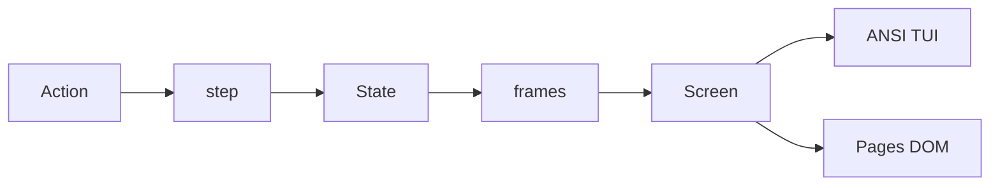

# Autumn Moon TUI parody

Unofficial parody of Aristocrat’s Dragon Link Autumn Moon. No real wagering, no Aristocrat assets, and no claim that the odds match a casino cabinet.

Aristocrat does not publish reel strips, hit rates, or return-to-player, and has treated that math as a trade secret. This project copies the player-visible rules and the on-screen layout. Credit values, reel strips, and jackpot growth rates are original, live in one module, and are printed on the rules page from that module.

## Shape

- [`src/engine/step.ts`](src/engine/step.ts) is pure: `(state, action, rng) => state`. Modes are base, free games, and Hold & Spin. Hold & Spin stores the mode to resume, so the feature can start during free games and then return.
- [`src/engine/screen.ts`](src/engine/screen.ts) turns a state into a `Screen`: four jackpot meters, a 5×3 grid of labeled cells, credits / bet / win, a feature line, and a status line. Reel stops, mystery-door flips, and orb reveals are extra `Screen`s from [`src/engine/frames.ts`](src/engine/frames.ts), so both UIs animate by painting those frames. No `print` and no DOM in the engine.
- [`src/tui/main.ts`](src/tui/main.ts) writes ANSI and reads keys.
- [`src/web/main.ts`](src/web/main.ts) paints the same `Screen` as a monospace grid and renders the rules under it.

Bun is the toolchain. `bun build --compile` produces a per-OS executable (one binary for macOS, Linux, or Windows from the same source). `bun build --target=browser` emits the static site. GitHub Pages only receives that site.

## Cabinet rules this parody implements

Public Autumn Moon behavior, in our own wording:

- 5 reels, 3 rows, 50 fixed lines, wins left to right. Total bet is `50 × coin`.
- Picture labels stand in for the cabinet art: `9` `10` `J` `Q` `K`, theme symbols `FAN` `KOI` `LOTUS` `DRGN`, `WILD` on reels 2–5 only, `MOON` scatter, gold `ORB`. Colors are ANSI approximations of the glass: muted ranks, red dragon, gold wild, gold orb, and green / blue / purple / red for Mini / Minor / Major / Grand.
- `WILD` substitutes for paying symbols. It does not substitute for `MOON` or `ORB`. `ORB` never pays on a line.
- 3 or more `MOON` symbols pay a scatter prize and start 6 free games. Five scatters pay 250× the total bet, which is the figure Aristocrat states on the [Autumn Moon page](https://www.aristocratgaming.com/us/games/us-autumn-moon). Pays for 3 and 4 scatters are original and listed on the rules page. Another 3 scatters during free games add 6 games.
- Free-game spins land mystery doors. After the reels stop, every door opens onto the same symbol, which may be an `ORB`.
- 6 or more `ORB`s anywhere start Hold & Spin with 3 respins. Each new orb locks in place and resets the count to 3. Locked orbs then show a credit multiple or a jackpot name.
- Mini and Minor are fixed prizes that scale with the coin (the commonly reported 1,000 and 5,000 credit pattern). Major can appear on at most one orb per feature and also has a local meter. Grand is never written on an orb; filling all 15 cells awards the Grand meter. Meters move only inside this session.
- A Major or Grand win pauses on a jackpot line until the player confirms, the TUI stand-in for the cabinet lock.

## Rules page

The Pages site is the game, then an article the bundle fills from the engine: the Alberta Tech “Vibe Coding is Gambling” reel, Dave Eddy’s YSAP Link stitch, what this parody keeps from Autumn Moon, the original paytable, and what a text screen cannot do (cabinet art, sound, linked progressives, 3D holds).

## Checks

Engine tests, no terminal required:

- A line win counts left to right; an orb on that line does not.
- Wild fills a line and does not replace a scatter or an orb.
- 3 moons go to free games with 6 spins; a retrigger adds 6; 5 moons pay 250× bet.
- Doors on one free spin all reveal one symbol.
- 6 orbs enter Hold & Spin; a new orb sets respins back to 3; 15 orbs pay Grand; a second Major orb does not appear.
- The same seed produces the same spin in the engine, the frame list, and a DOM paint of the resulting `Screen`.
