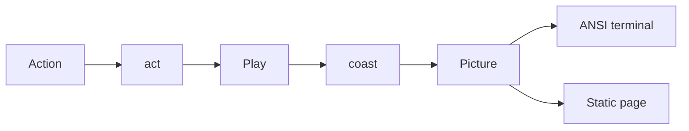

# Autumn Moon plaintext

Unofficial parody of Aristocrat’s Dragon Link Autumn Moon. No real wagering, no Aristocrat assets, and no unpublished cabinet math.

This folder is the second build. [v1](../v1/PLAN.md) is the earlier screen, with tiles and its own engine. v2 does not import v1. The pay numbers live in [`src/game.ts`](src/game.ts) so this build stands alone. v1 is left as it was.

Aristocrat does not publish reel strips, hit rates, or return-to-player. This project copies the player-visible rules. Credit values, reel strips, door chances, orb weights, and jackpot growth are original. The rules article prints the pays from that same module.

## What changed while building v2

The first plan assumed one engine, one screen model, an ANSI app, and a static page. Those parts stayed. The screen and the controls changed after the first plaintext pass.

- The page is a static bundle. GitHub Pages cannot start the terminal, so the browser paints the same text itself. `bun run page` writes [`page.js`](page.js), and that file is committed so the page works without a build step on the host.
- The screen is what a terminal shows. Bracket cells, no boxes, no tiles, and no button row. The page width is the reel width.
- The line under the reels is a tip. It states the rule of the current mode. It does not pay and it does not start a feature. Slot text has no full stops. The rules article under the board still uses sentences.
- A reserved row above the reels holds `SPINNING`, `WINNER`, `FREE GAMES`, `MYSTERY DOORS`, or `HOLD & SPIN`. That row stays in the layout so the screen does not grow and shrink. On the page it is an inline span, because a block inside the pre element added a blank line.
- Jackpot names and values share the reel width. Each value sits on the center of its name. A leftover column goes to the right, so `1,000` does not hang past `MINI`.
- The top bar uses the same color as the status bar. Play and a win are the same green. Free games, doors, Hold and Spin, Major, and Grand each have their own color. Winning cells are white with dark text.
- `Credits`, `Bet`, and `Win` are capitalized. The credit balance does not scale when the coin changes. The coin value shown is the coin number. Coins are 1, 2, 5, and 10, and only the base game can change them.
- One press plays one spin. The result is chosen on that press, then the reels coast to a stop on their own. Orb faces turn a little slower than the reels. Holding Enter does not start another spin and does not spend a Hold and Spin respin. In the feature name, “hold” means the orbs stay locked.
- A broke spin, a door open, and a jackpot collect go through the same one-press path. A spin that cannot be paid says so and does not roll.
- Named states jump to a finished play for checking the screen. The names are `win`, `free`, `doors`, `arm`, `hold`, and `grand`.

## Shape

- [`src/game.ts`](src/game.ts) is the game. `act(play, key, chance)` returns the next play. Keys are `spin`, `coinUp`, and `coinDown`. Phases are `base`, `free`, `doors`, `arm`, `hold`, and `jackpot`. Hold stores the mode to resume, so the feature can start during free games and then return. `live` and `scripted` supply the chance. The game does not print and does not touch the DOM.
- [`src/text.ts`](src/text.ts) turns a play into text. `plain` is the uncolored screen. `picture` adds a color and a highlight on every cell. `coast` builds the frames between two plays. `ansi` and `markup` paint one picture for the terminal and the page.
- [`src/tui.ts`](src/tui.ts) reads raw keys and writes ANSI. `q` quits.
- [`src/page.ts`](src/page.ts) fills `#screen`, `#status`, and `#rules` in [`index.html`](index.html). Enter or Space spins. Left and Right change the coin.

Bun runs the tests and the terminal. `bun build --target=browser` emits the page bundle.

## Screen

The board is 53 columns. That is five cells of width 9 and four gaps of two spaces.

A cell is a label centered in a width-5 field, with brackets around it. `[   9   ]` is one character. `[  ORB  ]` is three. `[ DRGN  ]` is four. `[ LOTUS ]` is five.

Four jackpot columns share those 53 columns. The widths are 13, 12, 13, and 12, joined by single spaces. Names are centered in those widths. Values use the same centers.

The rows, from top to bottom, are the title, a blank line, the jackpot names, the jackpot values, a blank line, three reel rows, a blank line, `Credits` / `Bet` / `Win`, the tip, and the status. The callout replaces the blank line above the reels and does not add a row.

Tips fit in 53 columns.

- `TIP: 6 or more ORB symbols start HOLD & SPIN`
- `TIP: A new ORB resets the respins to 3`
- `TIP: Doors open onto one symbol, N free games left`

Colors follow the glass, as text color rather than cabinet art. Ranks are white. Fan is gold. Koi is orange. Lotus is pink. Dragon and Grand are red. Wild and Moon are yellow. Orb is orange. Mini is green. Minor and Door are blue. Major is purple. A winning cell is white with dark text. A locked orb keeps a thin inner edge.

The status bar and the matching top bar use one color for the mode. Play and win are green `#1f7a3a`. Free games are blue. Doors are a brighter blue. Hold and Spin is orange. Major is purple. Grand is red. A spin is gold on brown. Not enough credits is gray.

## How a press plays

`act` chooses the next play before any frame is drawn. `coast` then slows the reels onto that result. Base reels stop from left to right, and each reel’s stop count shifts a little with the landed symbol. A base spin that does not change the window, including a spin without enough credits, draws one frame and does not roll.

During Hold and Spin the locked cells stay put. Open cells cycle through faces and then land. A respin that misses still turns the open cells. Those faces use a slower pace than the reels.

The page ignores a repeated keydown. A key that is still down cannot start the next spin. Releasing it, or leaving the window, clears that latch. The terminal ignores further spin keys until the coast has finished and the key has been quiet.

## Cabinet rules this parody implements

Public Autumn Moon behavior, in our own wording.

- 5 reels, 3 rows, 50 fixed lines, wins left to right. The bet is `50 × coin`. A new play starts with 50,000 credits.
- Labels stand in for the cabinet art. `9` `10` `J` `Q` `K`, then `FAN` `KOI` `LOTUS` `DRGN`. `WILD` lands on reels 2 to 5 only. `MOON` is the scatter. `ORB` is the gold orb. `DOOR` appears only on a free spin, before the doors open.
- `WILD` substitutes for paying symbols. It does not substitute for `MOON` or `ORB`. `ORB` never pays on a line. The line symbol is read from reel 1, which cannot be wild.
- Line pays are in coins, then multiplied by the coin. Three, four, and five of a kind pay 5/15/80 for `9`, 5/15/90 for `10`, 5/20/100 for `J`, 10/25/120 for `Q`, 10/30/150 for `K`, 15/50/200 for `FAN`, 20/60/250 for `KOI`, 25/80/300 for `LOTUS`, and 40/150/800 for `DRGN`. All 50 lines pay, so three full rows of `KOI` pay `50 × 20` coins.
- 3 or more `MOON` symbols pay anywhere and start 6 free games. Three pay 3× the bet, four pay 20×, and five pay 250×. At coin 1 those are 150, 1,000, and 12,500. Another 3 moons during free games add 6 games. Free spins cost nothing.
- A free spin may land `DOOR` cells. The next press opens every door onto one face. One door does not fill the other cells.
- 6 or more `ORB` symbols start Hold and Spin. The window shows the orbs first. The next press reveals their faces and starts 3 respins. Each new orb locks and resets the count to 3. At most one `MAJOR` can appear. `GRAND` is never written on an orb. Filling all 15 cells awards Grand. 15 orbs on the triggering spin finish immediately and pay Grand.
- Orb credit faces, at coin 1, are 50, 100, 150, 250, 400, and 750. Their weights are 30, 24, 14, 9, 5, and 2. Mini weighs 5, Minor 1.5, and Major 0.3. Numeric labels rescale with the coin for display. Mini is 1,000 coins. Minor is 5,000 coins. Major starts at 25,000 coins and adds 0.01 per coin bet. Grand starts at 250,000 coins and adds 0.004 per coin bet. Both grow on every paid base spin and reset after they pay. The meters belong to this session. They are not a linked progressive. The displayed prize is the floored coin multiple, so a single paid spin may not move the integer at coin 1.
- Credit prizes on the orbs pay when the feature ends. A Major or Grand then pauses. Each following press collects one of them, Major first. Spin does nothing else during that pause. The running orb total stays in `Win` until the feature pays.
- Hold and Spin that starts during free games returns to those free games.
- The same seed plays the same game twice.

## Rules page

The page is the game, then a short help line, then an article filled from the pay list. The article names the Alberta Tech “Vibe Coding is Gambling” reel and Dave Eddy’s YSAP Link stitch, says the credits are pretend, lists the rules of this version, and states that the strips and weights are original. Parody sentences do not contain digits. The numbers come from the pay list and the coin.

## Checks

`bun test` covers the game without a terminal.

- The plaintext screen is 53 columns, the Mini value sits on its label, the tip fits, and the credit line reads `Credits`, `Bet`, and `Win`.
- A line win counts left to right. An orb on a line does not pay. Three rows of `KOI` pay on all 50 lines.
- Wild completes a line and does not stand in for a moon.
- Five moons pay 250 times the bet and start six free games.
- Doors on one free spin open onto one symbol.
- A new orb resets the respin count. Fifteen orbs pay Grand. A second Major does not appear.
- Winning cells light up, and the reels stop one at a time.
- The rules article explains the parody and the pays.
- The same seed plays the same game.
- `stage` returns a finished play for `win`, `free`, `doors`, `arm`, `hold`, and `grand`, and returns null for an unknown name.

Open a named state with `bun src/tui.ts <name>`, with `?state=<name>` on the page, or with `autumnState(name)` in the page console.
