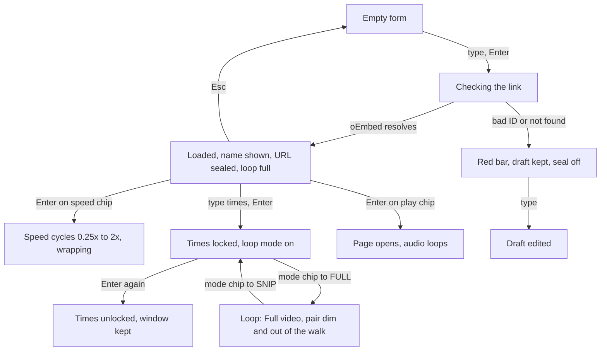
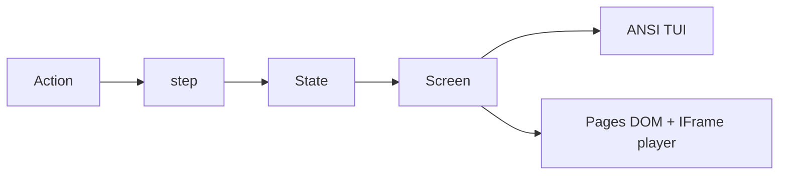

# Loop Song TUI

Loop the audio of one YouTube video — the whole thing or a marked snippet — in the
spirit of [looptube.io](https://looptube.io/). One screen, no library, no saving.
Every rule in [`../Dragon_Link/Guidelines_v1.md`](../Dragon_Link/Guidelines_v1.md)
applies.

**Decision carried from planning:** the audio plays on the page, not in the
terminal. A terminal cannot fetch or play YouTube audio without `yt-dlp` plus
`mpv`, which breaks guideline 9. So the TUI is the composer — it builds the loop
and launches it in the browser — and the page is the player. If real
in-terminal playback is wanted later, it arrives as an alternative TUI shell
over the same engine (`mpv` JSON IPC); nothing else changes.

**What got cut from the first plan:** the library screen, persistence
(`~/.loop-song.json`, localStorage), notes, delete, and the share screen. The
loop-URL codec stays — it is ~10 pure lines and it is how the TUI hands a loop
to the browser.

## Flow



## Shape



- `src/game.ts` is pure: `step(state, action)` returns the next state. One
  phase, one screen. The state is the focused spot, the URL draft and its
  seal, the load status (`idle | checking | loaded | notFound | badLink`),
  the video (`videoId`, `title?`), the snippet draft (`start`, `end` as typed
  strings), the confirmed snippet (seconds), the speed, the loop mode
  (`full | snippet`), and the play arm.
  - Actions: `{ type: "type", ch }` and `backspace` feed the focused spot —
    the sanctioned exception to data-free actions; `focus` moves between the
    six spots; `accept` is the one Enter: it acts on whatever spot holds the
    caret (load or unlock the URL, confirm or unlock the times, toggle play,
    cycle speed, toggle mode); `titled` and `notFound` are what a shell sends
    after its oEmbed check; `restart`.
  - The spots group into three sections in screen order — URL, chips
    (Play/Speed/Mode), times (Start/End). `nudgeSpot` jumps between sections
    on a torus; `nudgeSide` walks a torus within a section (the URL stands
    alone). A sealed pair — mode full with a kept window — leaves the walk
    entirely; only the mode chip's toggle returns it.
  - Locks gate typing, never focus: a sealed URL and confirmed times stay in
    the section walk, because their Enter is the unlock. Unlocking the times
    keeps the confirmed window — the loop plays on until a new pair confirms.
  - The engine never fetches and never sleeps: both shells check oEmbed
    between `accept` and `titled`, the same way the Tic Tac Toe shells own the
    opponent's one-second pause.
- `src/share.ts` is the loop-URL codec: `encode(state)` builds
  `…/Loop_Song/#v=<id>&s=<start>&e=<end>&z=<speed>&m=<mode>`, `decode` reads it
  back. Round-trip tested. The TUI launches this URL; the page loads it on
  entry.
- `src/text.ts` paints the one screen. Fixed height, board width 39.
- `src/tui.ts` writes ANSI and reads keys. Up and down jump between the
  sections; left and right walk within one; Enter acts on the focused spot.
  Enter on the play chip composes the loop URL and opens it with the OS opener
  (`open` on macOS — a builtin, not an installable dependency; set
  `LOOP_SONG_OPEN=0` and it stays put instead). It fetches the title from
  YouTube's keyless oEmbed endpoint after `accept`; offline or private videos
  fall back to the raw videoId.
- `src/page.ts` and `index.html` paint the same layout on black with a small
  IFrame player above it (YouTube's terms require a visible player, and
  browsers need a gesture before sound — the first Enter on Play or click
  starts it). The page runs the same oEmbed check as the terminal, so a typed
  URL settles to loaded without the hash. It polls `getCurrentTime()` and
  seeks back to the snippet start when the playhead passes the end. Speed maps
  to `setPlaybackRate`. The loop row becomes the live progress bar here —
  zoomed to the snippet window in snippet mode, so the bar tracks the loop
  itself rather than the whole video.

## The screen

```
LOOP SONG

Video to load:
https://youtu.be/dQw4w9WgXcQ
[ Confirmed - Enter to Edit ]

Never Gonna Give You Up · Rick Astley
Loop: 12.0s → 18.0s (6.0s)

[ Pause ]  [ 1.25x ]  [ Loop: SNIP ]

Start / End Timings (in seconds)
Start: 12
End:   18
[ Confirmed - Enter to Edit ]

↑↓ = Move, ←→ = Switch, Enter = Toggle
Esc = Reset, Ctrl-C = Quit
```

- **Three sections, six spots.** Up and down jump between the sections in
  screen order — URL, chips, times — wrapping at both ends; left and right
  walk within a section (the chip row, Start↔End; the URL stands alone). The
  focused piece renders hot. The video name and the loop row are display only
  and never take the caret.
- **Section locks, and buttons that say what they do.** A good load seals the
  URL: the field stops typing and the button reads green
  `[ Confirmed - Enter to Edit ]`; Enter on the URL unlocks it again. The
  times lock the same way — Enter confirms, Enter again unlocks for editing
  while the confirmed window keeps looping — and a locked pair renders green
  instead of orange. An empty pair ignores Enter, and a half-typed pair hops
  the caret to the missing field, so Enter never flashes red on a work in
  progress; red waits for a whole pair that cannot parse or runs backwards.
  And while the loop plays the full video on purpose — mode FULL with a kept
  window — the pair seals itself away: it leaves the section walk, dims, and
  its button reads `[ Loop is FULL ]`; the mode chip is the way back.
- **The load button** carries the pipeline: dim `[ Enter to load ]` when
  idle, yellow `[ Checking ]` while checking, green
  `[ Confirmed - Enter to Edit ]` once loaded and sealed, red `[ Bad link ]`
  or `[ Not found ]` on failure, with the draft kept for editing.
- **The loop row** is honest per shell. The TUI shows the confirmed window as
  text — it cannot know the duration, so it draws no bar. The page draws the
  live bar: in snippet mode the bar spans the window only, zoomed in so a
  short loop moves as fast as it feels; in full mode it tracks the whole
  video with the playhead pip inside it.
- **Chips, above the timings.** `[ Play | Pause ]` launches the loop (TUI,
  only on the arming edge) or toggles the player (page), and reads green
  while armed. `[ 1.00x ]` cycles YouTube's speed steps (0.25x to 2x,
  wrapping), gold whenever the speed is not 1. `[ Loop: FULL | SNIP ]`
  toggles the mode — refused until times are confirmed — gold in snippet
  mode. Enter on a focused chip is the only way in.
- **Snippet section.** Times are typed in seconds — digits and a dot are the
  only keys the fields take — confirmed with Enter, validated as
  `0 ≤ start < end` (against the real duration on the page). Enter on a
  half-typed pair hops the caret to the missing field. Until a video loads
  the section sits dim, and while the loop runs FULL over a kept window it
  sits out of the walk as well.

## Key map

One map across both shells (guideline 25), dense hints on screen (guideline 26).
No letter commands remain: every action is an arrow or an Enter, so no field
  can shadow a key.

| Key | Acts |
| --- | --- |
| ↑ ↓ | jump between the sections in screen order (URL, chips, times), wrapping; a sealed pair sits out |
| ← → | walk within the focused section (chips, Start↔End); the URL stands alone |
| Enter | act on the focused spot: load/unlock the URL, confirm/unlock the times, toggle play, cycle speed, toggle mode |
| Esc | reset to the empty form |
| Ctrl-C | quit (terminal only) |

On the page, clicks mirror the keys (guideline 33): a click focuses its spot
first, then sends the same Enter. A `#v=…` hash on entry loads a shared loop
straight into the loaded state.

## Colors

- Title gold, the repo standard.
- The URL field cyan, Start and End orange, matching the repo's two-endpoints
  pairing from Tic Tac Toe. Locked times turn green: the pair is confirmed.
- The focused spot renders dark text on its color; every button and chip
  carries its own state color — dim when idle, yellow while checking or set
  apart from 1, green when confirmed or armed, red on failure — so no
  separate outcome bar is needed.

## New patterns beyond the guidelines

Flagged for the next distillation round:

1. **Typing screens.** The engine owns the drafts and the caret; shells forward
   printables. Action types carry data here and nowhere else.
2. **Read-only network in a shell.** The oEmbed title check is one keyless
   GET, sent back into the engine as an action, like the Tic Tac Toe
   timer. The engine stays pure. Both shells run it — the page cannot lean
   on the hash path alone.
3. **Shell-crossing by URL.** The TUI hands a loop to the browser as a composed
   URL — no shared process state, the codec is the contract.
4. **Section locks.** A confirmed section seals itself and unlocks on Enter.
   Locks gate typing, never focus: the section walk must always reach the
   unlock. One deliberate exception: a pair kept while the loop runs FULL
   steps out of the walk entirely, because its way back is the mode chip, not
   Enter on the fields — the walk still reaches the way back.

## Verify

`tsc --noEmit`, then `bun test`. Drive the terminal binary through a real pty:
type a URL, load it, watch the title arrive and the seal close, arrow down
through the three sections and left and right through the chip row, type and
confirm a snippet, Enter again to unlock it, cycle the speed chip, toggle the
mode chip, Enter on Play and watch the browser take the loop, reset with Esc,
quit. Serve the page on 127.0.0.1 and check by hand: a typed URL settles to
loaded through the page's own oEmbed check, the loop seeks at the snippet end
and the live bar spans the snippet window, the chips work by Enter and by
click, a `#v=…` hash lands loaded. Stop the server after.

## Build and deploy

`scripts/build.ts` matches the other games: `bun build --compile` emits
`dist/loop-song`, `Bun.build` bundles the page into `docs/` as an IIFE with
`.nojekyll`. Add `Loop_Song` to the Pages workflow's folder list and the site
index in the same change — the workflow names folders explicitly, so it will
not pick the new game up on its own.

## Commits

One logical change per commit, in order: engine, tests, screen, TUI, web,
build, pages. Push when the session's work is done.
