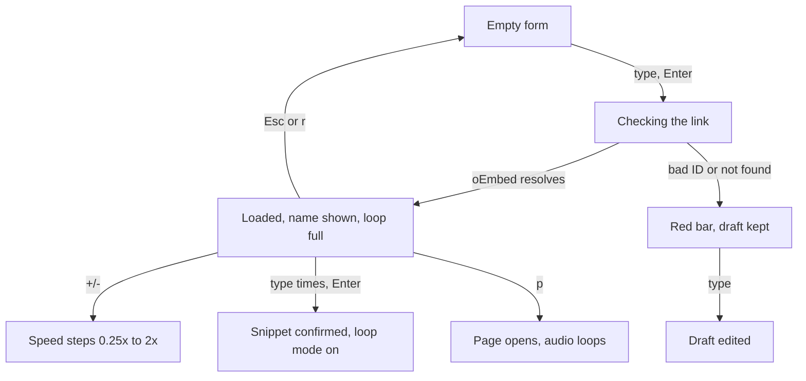
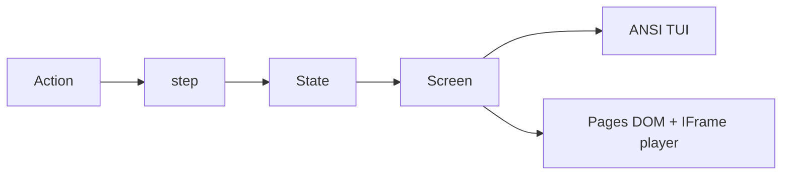

# Loop Song TUI

Loop the audio of one YouTube video — the whole thing or a marked snippet — in the
spirit of [looptube.io](https://looptube.io/). One screen, no library, no saving.
Every rule in [`../Dragon_Link/Guidelines_v1.md`](../Dragon_Link/Guidelines_v1.md)
applies.

**Decision carried from planning:** the audio plays on the page, not in the
terminal. A terminal cannot fetch or play YouTube audio without `yt-dlp` plus
`mpv`, which breaks guideline 9. So the TUI is the composer — it builds the loop
and launches it in the browser — and the page is the player. If real
in-terminal playback is wanted later, it arrives as an alternative TUI shell
over the same engine (`mpv` JSON IPC); nothing else changes.

**What got cut from the first plan:** the library screen, persistence
(`~/.loop-song.json`, localStorage), notes, delete, and the share screen. The
loop-URL codec stays — it is ~10 pure lines and it is how the TUI hands a loop
to the browser.

## Flow



## Shape



- `src/game.ts` is pure: `step(state, action)` returns the next state. One
  phase, one screen. The state is the URL draft, the load status
  (`idle | checking | loaded | notFound | badLink`), the video (`videoId`,
  `title?`), the snippet draft (`start`, `end` as typed strings), the confirmed
  snippet (seconds), the speed, and the loop mode (`full | snippet`).
  - Actions: `{ type: "type", ch }` and `backspace` feed the focused field —
    the sanctioned exception to data-free actions; `focus` moves between the
    three fields; `accept` acts on the focused field (load the URL, or confirm
    the snippet); `titled` and `notFound` are what a shell sends after its
    oEmbed check; `nudgeSpeed`; `toggleMode` (snippet mode refuses without a
    confirmed snippet); `arm` (play intent); `restart`.
  - The engine never fetches and never sleeps: the TUI checks oEmbed between
    `accept` and `titled`, the same way the Tic Tac Toe shells own the
    opponent's one-second pause.
- `src/share.ts` is the loop-URL codec: `encode(state)` builds
  `…/Loop_Song/#v=<id>&s=<start>&e=<end>&z=<speed>&m=<mode>`, `decode` reads it
  back. Round-trip tested. The TUI launches this URL; the page loads it on
  entry.
- `src/text.ts` paints the one screen. Fixed height, board width 39.
- `src/tui.ts` writes ANSI and reads keys. On a typing field, printable keys
  and Backspace edit the draft. On `p` it composes the loop URL and opens it
  with the OS opener (`open` on macOS — a builtin, not an installable
  dependency; if you would rather it never spawn anything, `p` prints the URL
  instead). It fetches the title from YouTube's keyless oEmbed endpoint after
  `accept`; offline or private videos fall back to the raw videoId.
- `src/page.ts` and `index.html` paint the same layout on black with a small
  IFrame player above it (YouTube's terms require a visible player, and
  browsers need a gesture before sound — the first `p` or click starts it).
  The page polls `getCurrentTime()` and seeks back to the snippet start when
  the playhead passes the end. Speed maps to `setPlaybackRate`. The loop row
  becomes the live progress bar here.

## The screen

```
LOOP SONG

Video to load
https://youtu.be/dQw4w9WgXcQ▌
[ Enter to load ]

Never Gonna Give You Up · Rick Astley
Loop: 12.0s → 18.0s (6.0s)

-  1.00x  +

[ P = Play ]     [ Loop: SNIPPET ]

Start Timing: 12
End Timing:   18
[ Enter to confirm ]

P = Play, +/- = Speed, M = Mode
             Loaded
Esc = Reset, Q = Quit
```

- **Three typing fields** — URL, Start, End — with a block caret on the focused
  one. Arrows move between them. Enter acts on the focused field, and the
  matching button row takes its status color.
- **The load button** carries the pipeline: dim `[ Enter to load ]` when idle,
  yellow while checking, green `[ Loaded ]` on success, red `[ Bad link ]` or
  `[ Not found ]` on failure, with the draft kept for editing.
- **The loop row** is honest per shell. The TUI shows the confirmed window as
  text — it cannot know the duration, so it draws no bar. The page draws the
  live bar: full-video track, snippet window lit, playhead pip inside it.
- **Speed** nudges in YouTube's steps (0.25x to 2x) on `+` and `-`, shown
  between the signs.
- **Play and mode chips.** `[ P = Play ]` launches the loop (TUI) or toggles
  the player (page). `[ Loop: FULL | SNIPPET ]` is the highlighted mode, cycled
  by `m`, refused in snippet mode until times are confirmed.
- **Snippet section.** Times are typed in seconds, confirmed with Enter,
  validated as `0 ≤ start < end` (against the real duration on the page).
  Until a video loads the section sits dim.

## Key map

One map across both shells (guideline 25), dense hints on screen (guideline 26).

| Key | Acts |
| --- | --- |
| Arrows | move between the URL, Start, and End fields |
| Enter | load the URL / confirm the snippet (focused field decides) |
| `+` `-` | nudge the speed |
| `P` | play — launch on TUI, play/pause on the page |
| `M` | cycle the loop mode |
| `R` / Esc | reset to the empty form (no parent screen to go back to) |
| `Q` | quit |

On the page, clicks mirror the keys (guideline 33). A `#v=…` hash on entry
loads a shared loop straight into the loaded state.

## Colors

- Title gold, the repo standard.
- The URL field cyan, Start and End orange, matching the repo's two-endpoints
  pairing from Tic Tac Toe. Speed yellow.
- The focused field renders dark text on its color; button rows take their
  status color (dim, yellow, green, red).
- The mode chip is hot when it differs from the default, the play chip hot
  when armed.
- The bar carries the outcome (guideline 29): yellow `Type a link` or
  `Checking`, green `Loaded` or `Snippet set`, red `Bad link` or `Not found`.

## New patterns beyond the guidelines

Flagged for the next distillation round:

1. **Typing screens.** The engine owns the drafts and the caret; shells forward
   printables. Action types carry data here and nowhere else.
2. **Read-only network in a shell.** The TUI's oEmbed title check is one
   keyless GET, sent back into the engine as an action, like the Tic Tac Toe
   timer. The engine stays pure.
3. **Shell-crossing by URL.** The TUI hands a loop to the browser as a composed
   URL — no shared process state, the codec is the contract.

## Verify

`tsc --noEmit`, then `bun test`. Drive the terminal binary through a real pty:
type a URL, load it, watch the title arrive, type and confirm a snippet, nudge
the speed, cycle the mode, reset with Esc, quit. Serve the page on 127.0.0.1
and check by hand: a real embed loads, the loop seeks at the snippet end, `p`
and speed work, a `#v=…` hash lands loaded. Stop the server after.

## Build and deploy

`scripts/build.ts` matches the other games: `bun build --compile` emits
`dist/loop-song`, `Bun.build` bundles the page into `docs/` as an IIFE with
`.nojekyll`. Add `Loop_Song` to the Pages workflow's folder list and the site
index in the same change — the workflow names folders explicitly, so it will
not pick the new game up on its own.

## Commits

One logical change per commit, in order: engine, tests, screen, TUI, web,
build, pages. Push when the session's work is done.
