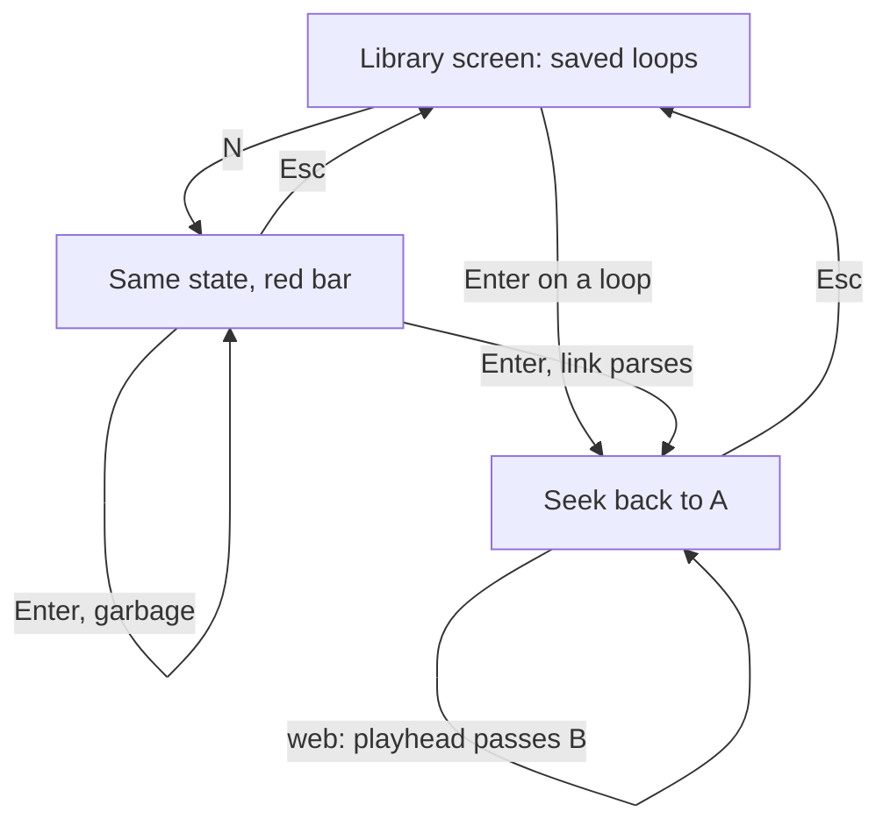
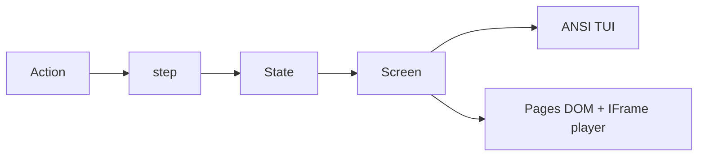

# Loop Song TUI

Loop any part of a YouTube video — a chorus, a riff, a phrase — over and over, in
the spirit of [looptube.io](https://looptube.io/): paste a link, set A and B
points, change the speed, take a note, save the loop, share it. Every rule in
[`../Dragon_Link/Guidelines_v1.md`](../Dragon_Link/Guidelines_v1.md) applies.

**Decision carried from planning:** a terminal cannot play YouTube audio or
video, and this repo allows no native dependencies. So the two shells split the
job honestly. The TUI is the loop workbench — library, editor, share links. The
web page is the player — the YouTube IFrame Player API (free, keyless,
static-hosting compatible) does the actual looping. One engine underneath, and
every loop made in the terminal plays on the page and back.

This bends guideline 8 (the page is the same text on black): Loop Song's page
adds the embedded player above the text controls. It is the one justified
departure — the page is the only shell that can play. Everything else stays
monospace on black.

## Flow



## Shape



- `src/game.ts` is pure: `step(state, action)` returns the next state.
  - `Loop = { videoId, note, start, end, speed, duration? }`. The videoId is
    YouTube's 11-character ID; `duration` is absent until a shell learns it.
  - The phase union is `library | paste | edit`. `paste` owns a draft string and
    a caret; `edit` owns the focused field. Both are engine state, not shell
    state, so navigation and typing stay testable (guideline 27).
  - Actions: `{ type: "type", ch }` and `backspace` feed the paste draft — the
    one place data must ride along (guideline 2's sanctioned exception);
    `accept` parses the draft (watch URLs, `youtu.be/`, `shorts/`, bare IDs —
    anything else returns the same state); `{ type: "open", index }`;
    `{ type: "nudge", field, delta }` (0.5s steps, clamped so
    0 ≤ start < end ≤ duration); `{ type: "set", field, value }` for
    mark-from-playhead; `{ type: "learn", duration }`; `{ type: "delete", index }`;
    `restart` (loop reset to 0:00 → end, speed 1x — the guideline-28 in-place
    reset); `back`.
  - `src/share.ts` is a pure codec: `encode(loop)` builds
    `…/Loop_Song/#v=<id>&s=<start>&e=<end>&z=<speed>&n=<note>`, `decode(hash)`
    reads it back. Round-trip tested. This is our answer to looptube's
    "swap youtube.com for looptube.io in the URL" trick — a shared link opens
    the page straight into the edit screen with the loop loaded.
- `src/text.ts` produces the three screens, every row ≤ the board width (39).
- `src/tui.ts` writes ANSI and reads keys. On the paste screen it forwards
  printable keys and Backspace to the draft instead of mapping actions — the
  first typing screen in this repo. It persists the library to
  `~/.loop-song.json` on every change and loads it at startup.
- `src/page.ts` and `index.html` paint the same text on black, with the IFrame
  player above it. The page polls `getCurrentTime()` and seeks back to A when
  the playhead passes B; speed maps to `setPlaybackRate`; player-ready sends
  `learn` with the real duration. Saves go to localStorage. `?state=` jumps to
  `library`, `paste`, or `edit` for manual testing, and a `#v=…` hash loads a
  shared loop on entry.

## Screens

**Library** — the top screen. The saved loops, one bracket row each, cursor hot
on the focused row. Empty is a state, not an error.

```
LOOP SONG

[ Chorus · dQw4w9WgXcQ · 0:12–0:18 ]
[ Solo  · aBc123XyZ-_ · 2:03–2:31 ]

Enter = Open, N = New, D = Delete
              2 loops
```

**Paste** — the typing screen. A bare draft line with a block caret; no
brackets, since it is a field, not a cell. Garbage keeps the draft and turns
the bar red.

```
LOOP SONG

Paste a YouTube link or video ID

https://youtu.be/dQw4w9WgXcQ▌

Enter = Add, Esc = Back
            Type or paste
```

**Edit** — the loop screen. Header names the loop, the timeline shows the whole
video with the loop window lit and (on the web) a playhead pip inside it, then
the four fields. The focused field wears its hot color.

```
LOOP SONG

Chorus · dQw4w9WgXcQ · 3:33

[·······██████████····|·······]

Start  0:12.40
End    0:18.05
Speed  1.00x
Note   Chorus

Arrows = Field, +/- = Nudge, Enter = Play
               Looping
Esc = Back, R = Reset
```

Times render as `m:ss.cs`. Until `learn` supplies a duration the timeline
renders fully dim and the header omits the length — the TUI shows what it
knows, never a guess.

## Key map

One map across both shells (guideline 25), dense hints on screen (guideline 26).

| Key | Library | Paste | Edit |
| --- | --- | --- | --- |
| Arrows | move cursor | — | move field focus |
| Enter | open loop | accept link | play (web) / save (TUI) |
| `+` `-` | — | — | nudge focused field |
| `N` | new loop | — | — |
| `D` | delete focused loop | — | — |
| `R` | — | — | reset to full video |
| Esc | no-op | back | back |
| `Q` | quit | quit | quit |

On paste, printable characters and Backspace edit the draft. On the web, clicks
mirror the cursor (guideline 33), and two text buttons — `[ Mark A ]` and
`[ Mark B ]` — set the focused time from the live playhead.

## Colors

- Title gold, the repo standard.
- Start owns cyan, End owns orange — the same pairing as Tic Tac Toe's X and O,
  and for the same reason: two endpoints of one act. Speed is yellow, Note is
  card.
- The timeline: dim dots outside the loop, the loop window in cyan, the
  playhead pip in magenta (web only).
- The focused field renders dark text on its color; unfocused fields stay
  plain (guideline 14).
- The bar carries the outcome (guideline 29): gray `2 loops` on library,
  yellow `Type or paste`, green `Looping`, red `Bad link`.

## Persistence and sharing

Both are shell concerns — the engine only validates data handed to it. The TUI
writes `~/.loop-song.json`; the page writes localStorage; both load through the
same engine-side `load(json)`, which drops anything malformed rather than
crashing. Share links are pure engine output (see `src/share.ts`): the TUI
prints the URL on the edit screen for copying, the page lives at it.

## New patterns beyond the guidelines

Flagged for the next distillation round:

1. **Typing screens.** The engine owns the draft and caret; shells forward
   printables. Action types carry data here and nowhere else.
2. **Persistence.** Storage belongs to the shells (config-file JSON, page
   localStorage); the engine stays pure and only validates what loads.
3. **Live external data.** The web feeds measurements back through actions
   (`learn` for duration, `set` from the playhead). The TUI renders without
   them — no lying UI, just less on screen.

## Verify

`tsc --noEmit`, then `bun test`. Drive the terminal binary through a real pty:
type a URL into the paste screen, nudge both ends past their clamps, reset with
`r`, Esc back, delete from the library, quit. Serve the page on 127.0.0.1 and
check by hand: a real embed loads, the loop seeks at B, a shared hash opens the
edit screen loaded. Stop the server after.

## Build and deploy

`scripts/build.ts` matches the other games: `bun build --compile` emits
`dist/loop-song`, `Bun.build` bundles the page into `docs/` as an IIFE with
`.nojekyll`. Add `Loop_Song` to the Pages workflow's folder list and the site
index in the same change — the workflow names folders explicitly, so it will
not pick the new game up on its own.

## Commits

One logical change per commit, in order: engine, tests, screen, TUI, web,
build, pages. Push when the session's work is done.
