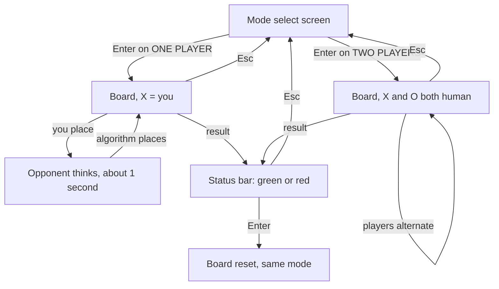
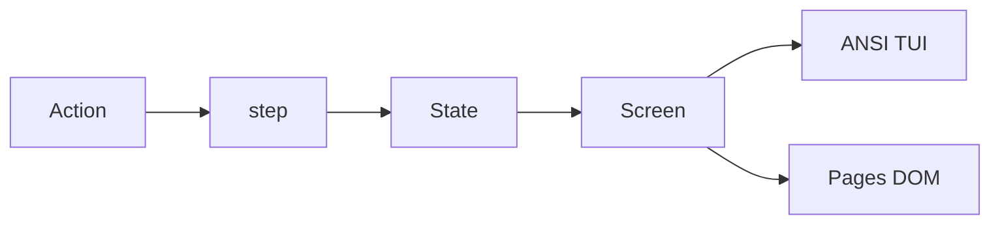

# Tic Tac Toe TUI

Tic Tac Toe (noughts and crosses) with two ways to play, chosen before the board
is drawn: **one player** against an algorithm, or **two players** sharing the
keyboard. No randomness, no paytable — every rule in
[`../Dragon_Link/Guidelines_v1.md`](../Dragon_Link/Guidelines_v1.md) applies.

**Decision carried from planning:** the algorithm is an unbeatable minimax player.
Perfect play cannot lose, so a well-played game against it ends in a draw — an
algorithm "designed to draw" in the strongest sense.

## Flow

## Shape

- `src/game.ts` is pure: `step(state, action)` returns the next state. Actions are
  `chooseSingle`, `chooseDouble`, `{ type: "place", cell: 0..8 }`, `restart`, and
  `back` (Esc). A cell is the one place an action carries data, so `step` validates
  it: an occupied cell, a finished game, an out-of-range index, or a cell placed
  during the opponent's pause returns the same state.
- The `mode` union is `select | playing | winX | winO | draw`. The state carries
  `opponent: "human" | "ai"` chosen on the select screen, and the winning line so
  the renderer can highlight it. X always moves first; the turn is derived from
  the move count, never stored.
- `src/ai.ts` is a pure `bestCell(state): cell` minimax over the same state
  machine. The engine never sleeps: both shells wait about one second, call
  `bestCell`, and send the resulting `place` action, so the pause is a shell
  concern and the engine stays free of timers.
- `src/text.ts` produces both screens.
  - **Mode select:** title, two options (`[ ONE PLAYER ]`, `[ TWO PLAYERS ]`),
    a cursor on the highlighted option, and a tip row. Arrows move, Enter chooses.
  - **Board:** title, a 3×3 grid of bracket cells `[ X ]`, the turn row, a tip row,
    and the status bar. The selected square is highlighted in the current player's
    color before Enter places. The screen never changes height; every row is
    limited to and centered on the board width.
- `src/tui.ts` writes ANSI and reads keys. Arrow keys move the cursor, Enter or
  Space places, `r` restarts, `Esc` returns to mode select, `q` quits. One
  keypress is one action. During the opponent pause the TUI keeps reading keys —
  `Esc` still works; placing does nothing.
- `src/page.ts` and `index.html` paint the same text on black. Keyboard input works
  as in the terminal, and a click on a cell maps to the same `place` action. The
  rules and the origins of the game sit under the board. `?state=` jumps to
  `select`, `xwins`, `owins`, `draw`, or `mid` for manual testing.
- `test/game.test.ts` and `test/ai.test.ts` hold behavior tests. `tsc --noEmit`
  stays clean and `bun test` passes before the build is done.

## Colors

- Player X is cyan, player O is orange, everywhere: the marks, the cursor
  highlight, and the turn row.
- The turn row reads `Turn: You (X)` / `Turn: CPU (O)` in single player and
  `Turn: Player 1 (X)` / `Turn: Player 2 (O)` in two players, always in the
  current player's color.
- The status bar at the bottom is yellow while the game is in progress. On a
  result it turns green for a win and red for a loss, with the text
  `Press Enter to reset board` on green and red.
  - Single player: green = you won, red = the algorithm won.
  - Two players: green = X won, red = O won.
- A draw needs a reset too, so it gets its own bar color (gray) with the same
  reset text.
- Winning cells are highlighted with dark text on the winner's color so they
  stand off the black board.

## Verify

`tsc --noEmit`, then `bun test`. Drive the terminal game through real keypresses:
both modes, a win in each, a draw, Esc from mid-game and from a result screen.
Serve the page on 127.0.0.1 for a visual check and stop the server after.

## Build and deploy

`scripts/build.ts` does what Autumn Moon v1 does: `bun build --compile` emits the
standalone terminal binary to `dist/tic-tac-toe`, and `Bun.build` bundles the page
into `docs/` as an IIFE with the rules inlined and a `.nojekyll` marker.

Pages serving: a repo with one game per folder cannot use the deploy-from-branch
`docs/` rule, which only reads the repo root. Add a small GitHub Actions workflow
that publishes each game's `docs/` bundle to the Pages site under its game folder
(`https://<user>.github.io/PyScripts/Tic_Tac_Toe/`). Relative paths in the bundle
make that work unchanged.

## Commits

One logical change per commit, in order: engine, tests, AI, screen, TUI, web,
build. Push when the session's work is done.
