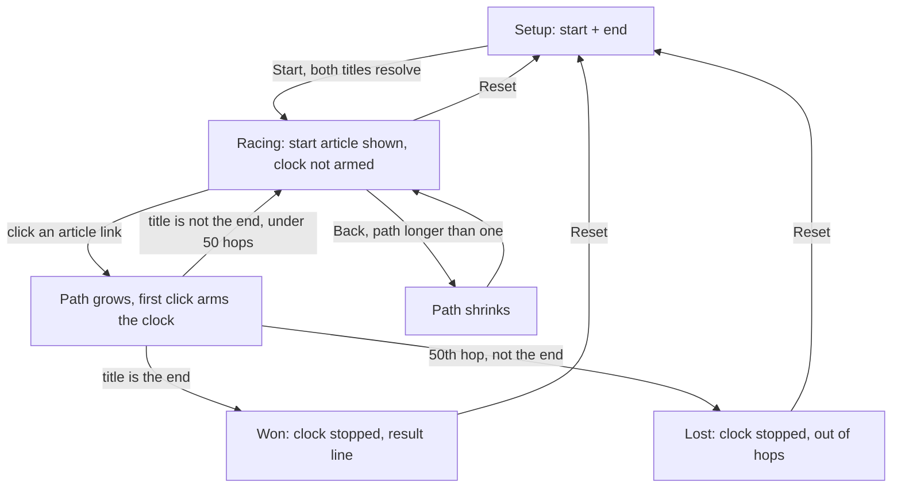
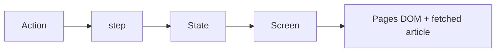

# Wiki Race

A Wikipedia speedrun. One player picks a start and an end article and shares the
race link; both players load it and click from the start article to the end
article as fast as they can. Fewest hops and fastest time win, compared by
pasting the result line — no server, no accounts. This page stands alone: no
rules from [`../Dragon_Link/Guidelines_v1.md`](../Dragon_Link/Guidelines_v1.md)
apply, terminal or web. No TUI, no `dist/` binary, one shell, and the barebones
page is the entire point.

**Decision carried from planning: the window renders fetched HTML, not a live
Wikipedia iframe.** Two walls block the iframe: Wikipedia sends
`x-frame-options: SAMEORIGIN` (the frame would be blank on GitHub Pages), and a
cross-origin frame cannot report its URL — so hops, the current page, win
detection, and Back would all be impossible even if it rendered. Instead the
page fetches the same barebones article HTML through Wikipedia's REST API
(`en.wikipedia.org/api/rest_v1/page/html/<title>`, anonymous CORS, verified)
and renders it wearing Wikipedia's own stylesheet. The window is the article
and nothing else — no sidebar, no search box — so "article links only" is
enforced by construction, not policed.

**What got cut from the first plan:** no leaderboard, no live opponent state,
no persistence, no random-pair generator. The race link is the whole contract
between the two players.

## Flow



## Shape



- `src/game.ts` is pure: `step(state, action)` returns the next state. Phases
  are the union `setup | racing | won | lost` — no boolean piles. `HOP_CAP`
  (50) is the sanity cap: the follow that reaches 50 hops without hitting the
  end page ends the race as `lost`, terminal like `won`. The state is the
  start and end titles (canonical, resolved by the shell before dispatch, the
  way Loop Song's `titled` arrives), the path (canonical titles; the current
  page is the last one), and `armed` (the clock has started).
  - Actions: `{ type: "start", start, end }`; `{ type: "follow", title }` — the
    one data-carrying action, validated in `step` like Tic Tac Toe's cell: a
    follow outside racing returns the same state. `back` pops the path and is a
    no-op at path length one. There is no reset action — Reset is a page
    button that throws the state away and starts from the initial one, hash
    cleared: a reload in place.
  - **The hop count is `path.length − 1`, derived, never stored** (the Tic Tac
    Toe turn rule). **The win check runs on every follow.**
  - The engine never fetches and never sees a timestamp. The shell owns the
    clock, exactly the way both shells own the opponent's one-second pause: it
    arms when the engine first reports `armed`, pauses while an article fetch
    is in flight, and resumes after the render — fetch latency is the
    network's, not the player's.
- `src/wiki.ts` is the only impure module.
  - `fetchArticle(title)` GETs the REST `page/html` endpoint. The API 301s a
    messy title to its canonical spelling (`/page/html/earth` →
    `/page/html/Earth`), so the final `response.url` normalizes case,
    underscores, and redirects for free; the article's `dc:isVersionOf` link is
    the fallback. Returns `{ html, canonical }`.
  - The setup form resolves both fields with the same call: `fetchArticle`
    runs once per field before a race starts, and the end must differ from
    the start. Both fetches land in the cache, so the start page paints
    instantly and the final hop to the end page is already local.
  - `prepare(html)` is pure: it strips every `<script>`, `on*` attribute,
    `target` attribute, and the `<base>` tag, marks every image
    `loading="lazy"`, and absolutizes protocol- and root-relative URLs. The
    shell runs it once per article, at the cache — never per render.
  - `classify(href)` is pure and tested: `./Foo` and `./Foo#Bar` are article
    links to `Foo`; `#cite_note-…` is in-page; red links (`action=edit`,
    `redlink`), `/w/…`, and every absolute URL are dead. The REST HTML speaks
    `./` relative hrefs; the classifier also takes `/wiki/Foo`, so a scrape
    style change is a one-line fix.
- `src/share.ts` is the race codec: `encode({ start, end })` builds
  `…/Wiki_Race/#s=<start>&e=<end>`, `decode` reads it back. Round-trip tested.
  A hash on entry starts the race cold — that is how two players load the same
  start page with zero coordination and no server.
- `src/page.ts` and `index.html` paint a barebones page: a header line with
  the race and a Reset button, a stats line with Back and the bold Hops
  (`n/50`) and Time, a `Path:` line with the route so far, and the window
  filling the rest. Default browser styling — the only styled thing on the
  page is Wikipedia's own article. `index.html` preconnects to
  `en.wikipedia.org` and `thumb.wikimedia.org`, so the first click skips the
  TLS handshake.
  - **The window is a same-origin iframe written with `document.write`**
    (`doc.open() / write() / close()`), not `srcdoc`. A srcdoc frame inherits
    our origin too, but its load event waits for every image before the page
    may wire clicks, and rewriting `srcdoc` races a stale document; the write
    is synchronous and deterministic, so anchors are rewritten and clicks
    wired the moment the HTML lands. `prepare` runs before injection: strip
    every `<script>`, `on*` attribute, and `target` attribute (nothing may
    open a new tab); drop the `<base>` tag (with it, `#cite` fragments
    resolve against en.wikipedia.org and navigate the frame away); make
    images lazy; absolutize asset URLs.
  - Rewritten anchors carry `data-title` and `href="#"`, so clicks, Enter, and
    middle-click all route through the page or go nowhere — there is no
    navigation the page does not perform itself.
  - Wikipedia's own stylesheet link (`/w/load.php?…`, absolutized to
    en.wikipedia.org by `prepare`) loads on the first article; every article
    after that paints already styled. The window looks like the Berkshire
    Hathaway page because it is that page's HTML.
  - An article click dispatches `follow` and fetches the next article; a dead
    link does nothing; an in-page anchor scrolls inside the window and is not
    a hop. A failed fetch shows a red note and changes nothing.
  - The timer paints `mm:ss` from a one-second interval. It arms on the first
    click, pauses at every fetch and resumes after the render or a failed
    fetch, and freezes on `won` and `lost` — the clock counts reading time
    only. `goBack()` resumes it too: Back cancels any in-flight follow, and a
    stale fetch returns without resuming.

## The screen

```
WIKI RACE                   Earth → Nation        [ Reset ]

[ ← Back ]                Hops: 3/50    Time: 01:12
Path: Earth → Planet → Solar System

+---------------------------------------------+
| Earth                                       |
|                                             |
|   … the fetched Wikipedia article, styled   |
|   by Wikipedia's own stylesheet, in its     |
|   own scrollable window …                   |
+---------------------------------------------+
```

Setup, before a race exists:

```
WIKI RACE

Start page: [ Earth            ]
End page:   [ Nation           ]

[ Start the race ]
```

Won:

```
WIKI RACE                          Earth → Nation

Nation reached in 4 hops and 02:35
[ Copy result ]
```

Lost, at the cap:

```
WIKI RACE                          Earth → Nation

Out of hops — the cap is 50 and "Nation" was never reached.
```

- **Back un-travels.** It pops the path and the hop count drops by one: hops
  measure the distance from the start along the current path, which is what
  "fewest redirects" means. (Flagged as a decision — if Back should cost a hop
  instead, it is a one-line change.)
- **The route line keeps its tail.** The path renders on one line; when it
  outgrows the window the oldest hops drop off the front
  (`… Planet → Solar System`), because the newest hops are the reference and
  the head is where the player has already been.
- **Reset clears everything.** One button in the header, always present: the
  race, the path, the clock, and the hash all go, and the setup form returns —
  the same state a fresh load without a hash gives.
- **The clock starts on the first article click**, not on load, so both players
  can load the race link, read the start page, and go when they are ready.
- **Only article links navigate.** Blue links live; red links, external links,
  and edit links are dead; citations and anchors scroll within the window. The
  window has no search box and no URL bar — it cannot leave Wikipedia because
  it is not a browser.
- **Normalization is free.** `earth`, `Earth`, and a redirect page all land on
  one canonical title through the redirect, so the win check is exact.

## Keys

Clicks are the interface. `Backspace` = Back (guarded against `event.repeat`)
is the one shortcut — a speedrun wants fast backpedaling — listened for in
both the page and the window, which is the same-origin written frame.

## Verify

`tsc --noEmit`, then `bun test`. Serve the page on 127.0.0.1 and drive it by
hand: create Earth → Nation, watch the timer arm on the first click and not
before, hop through articles, watch the timer freeze while a slow fetch is
in flight and resume after the render, win and copy the result, Back and
watch the hop count drop, follow the same link again, click a red link and an
external link and watch nothing happen, click a citation and watch it scroll
inside the window, reload with the race hash and land racing, Reset from
mid-race, from the win screen, and from the lost screen and land on a clean
setup form with the hash gone. Leave the server running after — the live
instance is the point of this app.

## Build and deploy

`scripts/build.ts` matches the other games minus the compile step: `Bun.build`
bundles `src/page.ts` into `docs/` as an IIFE with `index.html` and a
`.nojekyll` marker. `package.json` keeps `test`, `typecheck`, and `build`; no
`tui` script. Add `Wiki_Race` to the Pages workflow's folder list and the site
index in the same change — the workflow names folders explicitly, so it will
not pick the new game up on its own.

## Future: the shortest path

Not live from the page, in practice. The action API (`api.php`) is open to
anonymous CORS with `origin=*`, and `prop=links` returns exactly the links a
player may click, with `generator=links` batching 50 pages per call. But a
breadth-first search from the start explodes: every popular article links to
hundreds of pages, so the frontier reaches tens of thousands of pages — and
tens of thousands of API calls — a few clicks deep. A live in-page search
would hammer Wikipedia and still take minutes. The realistic path is a
`scripts/shortest.ts` in this folder (the games' script pattern) that runs the
same search locally, caches each frontier to disk, and commits the path as
JSON the page can load instantly.

## Commits

One logical change per commit, in order: engine, tests, wiki, page, build,
pages. Push when the session's work is done.
